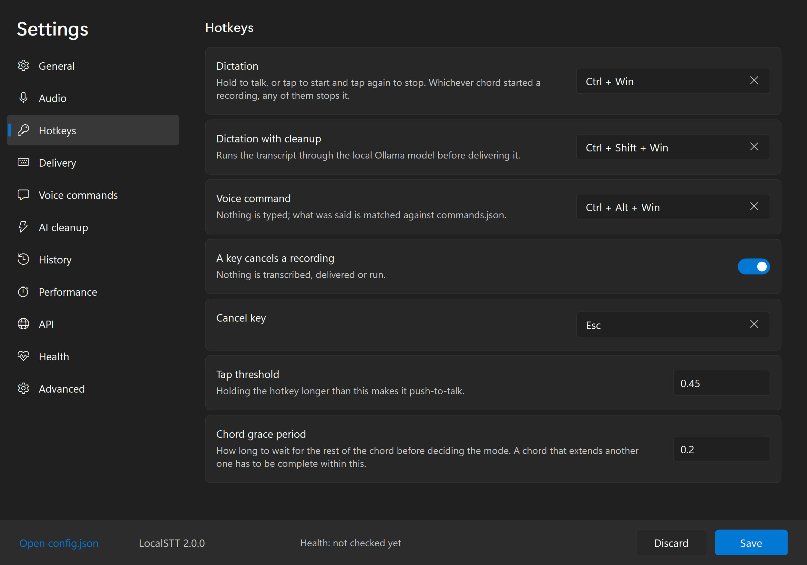
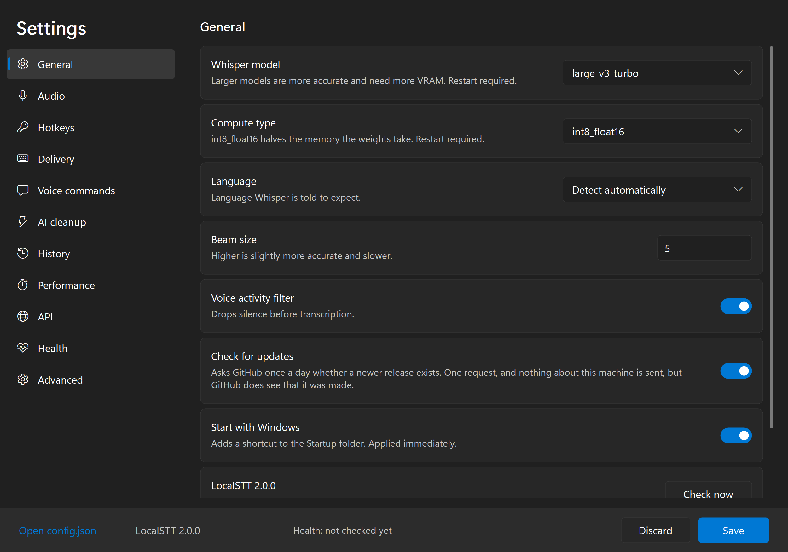
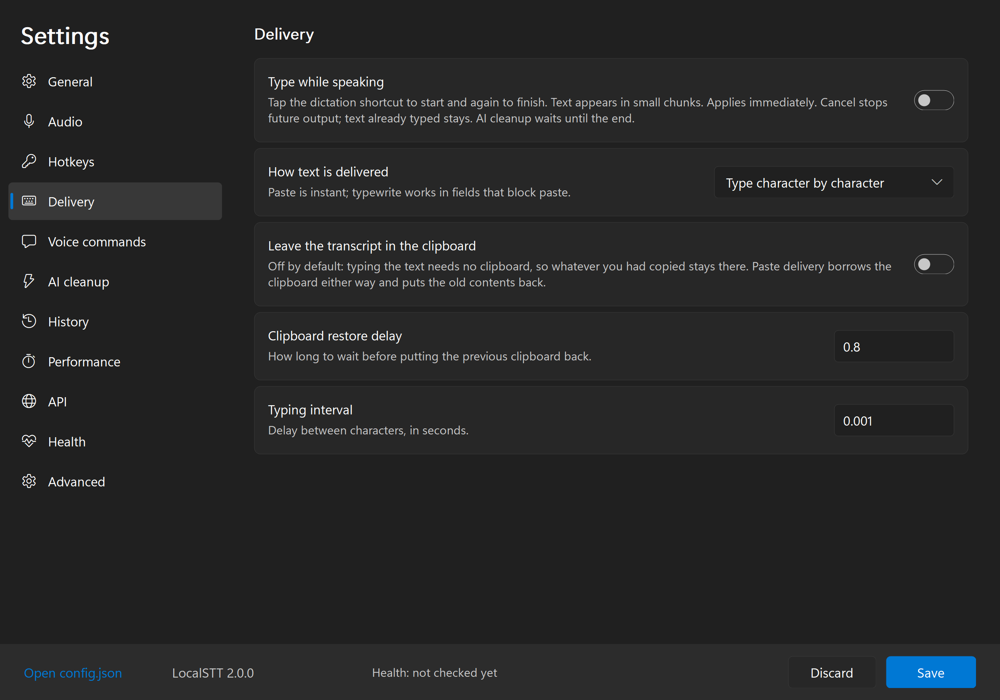

# LocalSTT

**Hold a hotkey, talk, let go — the text is typed where your cursor already is.**
Speech recognition that runs entirely on your own GPU, with a Windows 11 tray app,
an optional AI cleanup pass and an OpenAI-compatible HTTP endpoint.

Nothing is uploaded. No account, no API key, no network calls except the ones you ask
for — the model is downloaded once and everything after that is local. The application
is native C++: no Python, no virtual environment, no CUDA Toolkit at runtime.

[Русская версия](README.ru.md)



---

## Contents

- [What it does](#what-it-does)
- [System requirements](#system-requirements)
- [Install](#install)
- [Hotkeys](#hotkeys)
- [Settings](#settings)
- [Delivery and the clipboard](#delivery-and-the-clipboard)
- [Dictionary](#dictionary)
- [AI cleanup](#ai-cleanup)
- [Voice commands](#voice-commands)
- [HTTP API](#http-api)
- [Self-test and health](#self-test-and-health)
- [Updates](#updates)
- [Autostart](#autostart)
- [Files and folders](#files-and-folders)
- [How it is built](#how-it-is-built)
- [Dependencies](#dependencies)
- [The Python version](#the-python-version)
- [Does it run on macOS or Linux?](#does-it-run-on-macos-or-linux)
- [Privacy](#privacy)
- [License](#license)

---

## What it does

| | |
| --- | --- |
| **Dictate anywhere** | Hold `Ctrl+Win`, talk, let go. The text goes into whatever field had focus — a browser, an IDE, a chat box, a terminal. Tap instead of hold to start, tap again to stop. |
| **Runs on your GPU** | Whisper on [CTranslate2](https://github.com/OpenNMT/CTranslate2), called directly from C++, `large-v3-turbo` by default. Several times faster than real time on a modern card. |
| **AI cleanup** | `Ctrl+Shift+Win` sends the transcript through a local [Ollama](https://ollama.com) model first, which strips filler words and fixes punctuation without changing what you said. |
| **Voice commands** | `Ctrl+Alt+Win` matches what you said against `commands.json` and runs it. Nothing is typed. Only listed actions can run. |
| **Types or pastes** | Types character by character by default, which works in fields that block paste; switch to clipboard paste when you want speed. |
| **Rebindable** | Every hotkey is yours to change, from the settings window. Any key, not just modifiers. |
| **HTTP API** | An OpenAI-compatible `/v1/audio/transcriptions` endpoint on `127.0.0.1`, so other tools can use the same running model. |
| **Says what is wrong** | A self-test checks the driver, VRAM, CUDA DLLs, microphone and port, and says what to do about each failure instead of crashing later. |

---

## System requirements

| | Required | Notes |
| --- | --- | --- |
| **OS** | Windows 10 version 2004 (build 19041) or newer, 64-bit | Windows 11 is what it is developed against; the tray menu and settings window draw the Windows 11 look. |
| **GPU** | NVIDIA, compute capability 7.0 or newer (RTX 20-series, GTX 16-series, Volta and up) | **There is no CPU fallback.** LocalSTT refuses to start without a usable CUDA device, and says why. |
| **VRAM** | 4 GB free for the default model | See the table below. On a tight card, drop the compute type to `int8_float16`. |
| **Driver** | NVIDIA 527.41 or newer | What the bundled CUDA 12 libraries need. No CUDA Toolkit installation is required — the application carries its own DLLs. |
| **Disk** | ~4 GB | ~2.2 GB of CUDA, cuDNN and CTranslate2 libraries, plus the model (1.6 GB for `large-v3-turbo`). A build from source keeps its downloads too: plan for ~10 GB. |
| **Build tools** | Only to build from source | Visual Studio 2022 Build Tools with *Desktop development with C++* (MSVC, Windows SDK, CMake). The release archive needs none of it. |
| **Microphone** | Any input Windows can see | Picked in `Settings → Audio`, or left on the Windows default. |
| **Ollama** | Optional | Only for the AI cleanup hotkey. Everything else works without it. |

VRAM the model actually needs, measured with `beam_size 5` on a ~30 s window:

| Model | float16 | int8_float16 | int8 | Download |
| --- | --- | --- | --- | --- |
| `large-v3-turbo` (default) | 2.4 GB | 1.5 GB | 1.2 GB | 1.6 GB |
| `large-v3` | 3.2 GB | 1.9 GB | 1.6 GB | 3.1 GB |
| `medium` | 1.8 GB | 1.1 GB | 0.9 GB | 1.5 GB |
| `small` | 0.9 GB | 0.6 GB | 0.5 GB | 0.5 GB |

Cleanup runs an Ollama model on the same card, so it has to fit in what is left over.
`Settings → AI cleanup` works out what fits and offers to download it.

---

## Install

Two ways in: unzip the release archive, or build from a clone.

### Download the archive

Releases carry two archives: `LocalSTT-<version>-win64.zip` with the application and
its runtime, and `LocalSTT-model-large-v3-turbo.zip` with the speech model. They are
separate because together they are over the 2 GB GitHub allows per file.

1. Unzip `LocalSTT-<version>-win64.zip` anywhere.
2. Unzip `LocalSTT-model-large-v3-turbo.zip` into that folder, so that
   `models\ctranslate2\large-v3-turbo` sits next to `LocalSTT.exe`. The model does not
   change between releases: when updating, keep the `models` folder instead of
   downloading it again.
3. Run `start-localstt.vbs`.

Nothing to install, no Python, no build tools. Use the archives if you just want the
thing to work.

### Build from source

```powershell
git clone https://github.com/iFrosta/localSTT.git
cd localSTT
.\install.ps1
```

That is the whole thing. The installer stays inside the folder it is run from:

1. checks Windows, the GPU and the C++ build tools, and says how to install the tools
   if they are missing,
2. downloads the pinned dependencies into `native\`, each checked against its SHA-256:
   CTranslate2, the CUDA and cuDNN libraries, the model and the Silero voice activity
   model. Python wheels are only opened as ZIP archives for their DLLs; no Python runs,
3. compiles `LocalSTT.exe` (the tray app) and `localstt-cli.exe` (the same program for a
   console) into `native-install\`, bundles the runtime next to them and runs the
   native test suite,
4. runs the self-test.

Useful switches:

```powershell
.\install.ps1 -Autostart        # also start LocalSTT with Windows
.\install.ps1 -Model large-v3   # bundle another model
.\install.ps1 -SkipBuild        # reuse the build in native-install\
.\install.ps1 -SkipSelfTest     # skip the check at the end
```

The first run downloads several gigabytes; later runs reuse every file whose hash still
matches. If PowerShell refuses to run the script, allow scripts for this session:

```powershell
Set-ExecutionPolicy -Scope Process -ExecutionPolicy Bypass
```

### Where it gets installed

By default LocalSTT runs from the folder you cloned into: portable, no admin, and
`git pull` followed by `.\install.ps1` upgrades it. To install it somewhere proper
instead, `-InstallTo` copies the finished application there, without the sources and
the build files:

```powershell
# Per user. No administrator, and this is the recommended one.
.\install.ps1 -InstallTo "$env:LOCALAPPDATA\Programs\LocalSTT"

# All users. Needs an elevated PowerShell.
.\install.ps1 -InstallTo "$env:ProgramFiles\LocalSTT"
```

The installed copy has the same layout as the release archive: the executables, their
DLLs, `models\`, `licenses\`, the files you edit and the scripts that run it.

If you do install for all users, everything still works: settings, history and logs
already live in `%APPDATA%\LocalSTT`, and an edit to `commands.json`, `dictionary.json`
or `cleanup-prompt.txt` from the settings window is written to a copy there rather than
failing against the read-only original.

One registry key is written, under `HKCU\Software\Classes\AppUserModelId`: the name
and icon Windows puts on LocalSTT's notifications. The uninstaller removes it. Nothing
else goes near the registry, and the folder can be moved or renamed afterwards — every
script finds itself. To undo it all, run the uninstaller **from the install folder**:

```powershell
.\uninstall.ps1           # stops it, removes autostart; in a clone, offers to delete the build and downloads
.\uninstall.ps1 -AppData  # also delete settings, history and logs
```

### Start it

```powershell
.\start-localstt.vbs   # tray only, no console
.\run-native.ps1       # the same, from PowerShell
.\run-dev.ps1          # localstt-cli.exe in this console
```

The launchers pass `--root` with their own folder, which is where `commands.json`,
`dictionary.json` and `cleanup-prompt.txt` are read from. Only one copy runs at a time;
stop it with `.\stop-localstt.ps1` or `Exit` in the tray menu.

The tray icon shows the state by colour: green ready, red recording or listening for a
command, amber transcribing or cleaning up. Left-click opens Settings, right-click the menu.

---

## Hotkeys

| Chord | What it does |
| --- | --- |
| `Ctrl+Win` | Dictation. Hold and release, or tap to start and tap again to stop. |
| `Ctrl+Shift+Win` | Dictation with AI cleanup before the text is delivered. |
| `Ctrl+Alt+Win` | Voice command. Nothing is typed. |
| any of the three | Stops whatever recording is running, whichever mode started it. |
| `Esc` | Cancels: nothing is transcribed, delivered or run. |

Hold longer than `hotkey_tap_seconds` (0.45 s) and it behaves as push-to-talk; a shorter
tap toggles instead.

### Changing them

`Settings → Hotkeys`. Click a field, press the combination, let go — the chord is
recorded by exactly the code that later has to recognise it.

- Any key can take part, not only modifiers. `F9` and `Ctrl+Alt+D` work as well as `Ctrl+Win`.
- The ✕ on the right of a field clears a binding, leaving that mode without a hotkey.
- Two modes cannot share a chord — saving says which two clash instead of applying it.
- A new chord takes effect on save. No restart.

They are stored in `config.json` as `hotkey_dictation`, `hotkey_cleanup`,
`hotkey_command` and `hotkey_cancel`, in the form `"ctrl+shift+win"`.

One subtlety: cleanup is dictation *plus* `Shift`, so both chords match the same keys.
The recording starts on the first chord and the mode is settled once
`hotkey_mode_grace_seconds` (0.2 s) has passed — long enough for the rest of a chord
pressed as one gesture. Bindings that do not overlap are unaffected.

---

## Settings

Click the tray icon, or right-click it → `Settings`. Every field in `config.json` is
here, grouped, with `Open config.json` at the bottom for the ones a UI should not pretend
to own. Changing the model, compute type, recognition backend or API port needs a
restart; everything else applies on save.



| Page | Holds |
| --- | --- |
| **General** | Model, compute type, language, beam size, voice activity filter, update check, start with Windows, the version |
| **Audio** | Microphone, sample rate, input normalisation |
| **Hotkeys** | The four bindings, the tap threshold and the chord grace period |
| **Delivery** | Typing vs pasting, the clipboard setting, typing speed |
| **Voice commands** | Every command with whether it works on this machine, and the timings |
| **AI cleanup** | Which Ollama model, whether it fits in the VRAM left over, and a download button |
| **History** | Off by default. On, every transcript is kept with its timestamp |
| **Performance** | How long the last dictation and cleanup took |
| **API** | Host and port |
| **Health** | The full self-test, re-runnable |
| **Advanced** | Recognition backend, model and voice activity model paths, the lists the dropdowns offer |

The microphone is a Windows `waveIn` device, saved as `native_microphone`. The
`microphone` number the Python version saves is kept but not used by the native app:
pick the device again, or leave it on the Windows default.

### Languages

`large-v3-turbo` is multilingual: one model, around a hundred languages, and the default
`auto` setting works out which one you are speaking on every dictation. Nothing needs
configuring for that — dictate in another language and it follows you.

The dropdown itself offers `auto`, `en` and `ru`, because pinning a language is a little
more accurate on short phrases and most people only ever use one or two. Any other code
works — add it to `allowed_languages` in `config.json` and it appears in the list:

```json
"allowed_languages": ["auto", "en", "de", "es"]
```

Turbo is a distilled model, so on some languages it is a little behind `large-v3`. If
yours is one of them, switch the model in `Settings → General`; the trade is about a
gigabyte of VRAM and some speed.

---

## Delivery and the clipboard



Two ways to get the text into the focused field:

- **Typewrite** (default) — sends the characters one at a time through `SendInput`.
  Works in fields that refuse a paste, and needs no clipboard at all.
- **Paste** — puts the text on the clipboard and sends `Ctrl+V`. Instant for long text.

**The clipboard is left alone by default.** Typing needs no clipboard, so whatever you
had copied is still there after dictating. Turn on `Leave the transcript in the
clipboard` (also in the tray under `Delivery`) if you want each transcript to end up
there as well. Paste delivery has to borrow the clipboard either way — with the setting
off, it puts the previous contents back afterwards.

The last transcript is always written to `%APPDATA%\LocalSTT\last-transcript.txt`,
whatever the clipboard setting says.

---

### Type while speaking

Enable **Settings → Delivery → Type while speaking** for incremental dictation.
The switch saves immediately and applies to the next recording. Tap the dictation
shortcut (Ctrl+Win by default) to start and tap again to finish. Holding it still
records, but delivery waits for modifiers to be released.

Confirmed words are typed in small chunks while recording. This uses faster decoding
and shorter context than transcription after Stop, so accuracy and punctuation can
differ. Already typed text is never rewritten. Cancel stops future output and leaves
text already typed in place. Cleanup dictation still waits for the complete recording.

Keep the cursor in the same field. If focus moves to another window, typing stops;
the full transcript is copied to the clipboard at the end. Otherwise live typing
respects **Leave the transcript in the clipboard**.

Settings reset scrolling when changing sections and keep Save/Discard visible.
Background GPU checks, restarts and utility scripts do not create console windows;
a script command can opt in with `"show_console": true`.

## Dictionary

Whisper mangles technical vocabulary, and it spells product names the way they sound
rather than the way they are written. `dictionary.json` addresses both:

```json
{
  "terms": ["CUDA", "cuDNN", "PostgreSQL"],
  "replacements": { "kuda": "CUDA", "postgres sequel": "PostgreSQL" }
}
```

- `terms` are given to the model as context, so it is likelier to spell them correctly.
  This is conditioning, not learning: Whisper's weights never change, and it remembers
  nothing between dictations. Whisper reads about 220 tokens of prompt and silently
  drops the rest, so a term list that keeps growing quietly stops working — the log says
  so when you cross the line.
- `replacements` are applied to the transcript afterwards, longest phrase first. This is
  the reliable half. If a word comes out wrong every time, fix it here rather than
  hoping a longer term list will help.

The file is re-read whenever it changes, so a new word takes effect on the **next
dictation** — no restart. The shipped one is a starting point; replace it with your own
vocabulary. An edited copy at `%APPDATA%\LocalSTT\dictionary.json` wins over the one in
the folder, so `git pull` cannot overwrite it.

---

## AI cleanup

`Ctrl+Shift+Win` transcribes and then rewrites the result with a local Ollama model
before delivering it: filler words out, punctuation in, meaning and language untouched.
Technical terms, paths, commands and code are explicitly left alone.

The model shares the GPU with Whisper, so the right one is whatever fits in the VRAM left
over. Let LocalSTT pick and download it:

```powershell
.\install-qwen-cleanup-model.ps1
```

To see the recommendation without changing anything:

```powershell
.\native-install\localstt-cli.exe --cleanup-model
```

To pick one yourself, adding `-Pull` if it still has to be downloaded:

```powershell
.\set-ollama-cleanup-model.ps1 -Model qwen3:4b-instruct -TimeoutSeconds 60
```

`Settings → AI cleanup` shows the same recommendation with a download button. Without
Ollama running, plain dictation is unaffected — only the cleanup hotkey needs it.

### Changing what cleanup does

The instructions the model is given live in `cleanup-prompt.txt`, and
`Settings → AI cleanup → Edit prompt` opens it. Rewrite it and the next dictation uses
the new wording — no restart. Ask for a different tone, translation into another
language, bullet points, a summary; the transcript is the user message and this file is
the system one.

Each dictation is a single stateless request to Ollama's `/api/chat`: one system message
holding this prompt, one user message holding the transcript. There is no conversation
and nothing is remembered between dictations, so the prompt is the only thing steering
the result.

An edited copy at `%APPDATA%\LocalSTT\cleanup-prompt.txt` wins over the one in the
folder. Empty the file to fall back to the built-in prompt.

---

## Voice commands

`Ctrl+Alt+Win` records, transcribes and matches against `commands.json`. Command mode
keeps listening and stops by itself as soon as something matches, so there is no need to
press the hotkey a second time:

- the running recording is transcribed every `command_poll_seconds` (0.9 s),
- an exact match runs immediately and ends the session,
- a wildcard match waits for `command_capture_silence_seconds` of silence first, so the
  captured text is the whole phrase and not half of it,
- if nothing matches, the session ends after `command_silence_timeout_seconds` of
  silence, or `command_listen_timeout_seconds` in total.

Set `command_auto_stop` to `false` (tray: `Command auto-stop`) for plain start/stop.

### Patterns

A command has to *open* the phrase, so chatter cannot trigger it. `lock the computer`
matches "Lock the computer." and "lock the computer please", but not "and then I said
lock the computer".

| Pattern | Matches |
| --- | --- |
| `lock the computer` | the phrase at the start of what was said |
| `add a task *` | the phrase at the start; the rest becomes the capture |
| `set a timer for * minutes` | a phrase around a capture |
| `*blackout` | anywhere in the sentence — opt-in, and easier to trigger by accident |

Order matters: the first command whose phrase opens the sentence wins, and
`open a terminal` also opens `open a terminal ubuntu`, so list the specific variants
before the general one.

### Command types

Only what is listed in `commands.json` can run. Speech never executes an arbitrary shell
command.

- **`process`** — an existing `.exe`, `.cmd`, `.bat`, `.ps1` or `.vbs` with a fixed
  argument list. `.ps1` runs through `pwsh.exe`, `.vbs` through `wscript.exe`.
- **`localstt`** — acts on the running app: `language`, `delivery` (`paste`/`typewrite`)
  or `repeat`, which delivers the last dictated text again.
- **`microsoft_todo`** — queued into `%APPDATA%\LocalSTT\todo-queue.jsonl` until
  Microsoft Graph is wired up.
- **`app_launch`** — opens whatever application the capture names, with no entry of its
  own.

Paths may use `%LOCALAPPDATA%`-style variables, or a bare executable name resolved
through `PATH`. A command may also declare what it needs:

| `requires` entry | Satisfied when |
| --- | --- |
| `path:C:\tools\Thing.exe` | that file exists |
| `exe:wsl.exe` | the name resolves through `PATH` |
| `appx:Microsoft.WindowsCalculator_8wekyb3d8bbwe` | that Store package is installed |
| `wsl:Ubuntu:htop` | `htop` is on the `PATH` inside the Ubuntu distro |

Commands whose target is missing are switched off automatically rather than failing when
spoken. `Settings → Voice commands` lists every command with the reason it is off, and
its toggle writes `"enabled": false` back into the file.

The shipped set is deliberately plain — lock, sleep, terminals, Notepad, Explorer, VS
Code, the `localstt` actions, a To Do capture and the catch-all launcher — and its
phrases are English. It is a starting point, not a vocabulary: a command may carry
phrases in as many languages as you like, since Whisper transcribes whichever one you
spoke.

```json
"patterns": ["lock the computer", "ordinateur verrouille", "sperr den rechner"]
```

Add your own, or put an edited copy in `%APPDATA%\LocalSTT\commands.json`, which wins
over the shipped one — that keeps your set out of git's way, and `git pull` can never
overwrite it.

### Launching applications

`app_launch` matches against every app the Start menu can open — desktop shortcuts, Store
packages and registered app ids alike, read from the shell's Applications folder. The index is cached in
`%APPDATA%\LocalSTT\app-index.json` and rebuilt daily, or on demand from
`Settings → Voice commands → Rebuild app index`.

Spoken names rarely match registered ones, so they are resolved through fuzzy matching,
transliteration (for dictation languages not written in the Latin alphabet) and an alias
file at `%APPDATA%\LocalSTT\app-aliases.json` (`Settings → Voice commands → Edit app names`):

```json
{ "chrome": "Google Chrome", "vs code": "Visual Studio Code" }
```

Results are logged to `%APPDATA%\LocalSTT\command-history.jsonl` (tray: `Command history`).

---

## HTTP API

The running app serves an OpenAI-compatible endpoint on `127.0.0.1:7777`, so other tools
can reuse the model that is already loaded.

```powershell
curl.exe -X POST http://127.0.0.1:7777/v1/audio/transcriptions `
  -F "file=@C:\path\sample.wav" `
  -F "model=large-v3-turbo" `
  -F "language=ru" `
  -F "response_format=json"
```

`language=auto` detects the language, `language=en` forces English. Or use the wrapper:

```powershell
.\transcribe-file.ps1 C:\path\sample.wav
```

`/health` and `/metrics` report the loaded model, the device, the version and the
timings. A request's `model` field does not swap the loaded model. Uploads are limited to
128 MiB, and there is no authentication: keep `api_host` on `127.0.0.1`.

---

## Self-test and health

LocalSTT tests itself every time it starts. It checks that the model loaded on a CUDA
device (and refuses a silent fall back to the CPU), the GPU and its VRAM, the
microphones, and whether Ollama answers and which cleanup model fits in what is left.
The self-test from the console also lists which voice commands this machine can run.

Only failures that make transcription impossible stop the app — a missing microphone or a
busy port are reported and it starts anyway. Run it any time from `Settings → Health`, or:

```powershell
.\run-diagnostics.ps1   # the self-test, without the tray app
.\health.ps1            # asks the running app instead
```

The last result is kept in `%APPDATA%\LocalSTT\preflight.json`.

---

## Updates

LocalSTT asks the GitHub releases API once a day whether a newer version has been
published, and says so in the tray if there is one. It is one `GET`; nothing about the
machine goes with it. The switch and a **Check now** button are on `Settings → General`,
and the footer of the settings window carries the installed version at all times — it
turns into a link to the new release when there is one.

Updating is manual, and depends on how it was installed: `git pull` and `.\install.ps1`
in a clone, or download the newer archive from
[Releases](https://github.com/iFrosta/localSTT/releases) and unzip it over the folder.
Settings and history live outside the folder, so neither loses them. The version comes
from one place, `localstt\__init__.py`, which the build reads.

---

## Autostart

`Settings → General → Start with Windows` adds or removes a shortcut to `LocalSTT.exe`
in the Startup folder and takes effect immediately. From a console:

```powershell
.\install-autostart.ps1
.\uninstall-autostart.ps1
```

---

## Files and folders

Everything the app writes lives in `%APPDATA%\LocalSTT`, never in the install folder:

| Path | What |
| --- | --- |
| `config.json` | Every setting |
| `logs\localstt-native.log` | The application log |
| `last-transcript.txt` | The most recent transcript |
| `history.jsonl` | Dictation history, if you turn it on |
| `command-history.jsonl` | What voice commands did |
| `performance.json` | Timings for the last dictation |
| `preflight.json` | The last self-test result |
| `update-check.json` | When updates were last checked, and the answer |
| `app-index.json`, `app-aliases.json` | The launcher's index and your name overrides |
| `commands.json`, `dictionary.json`, `cleanup-prompt.txt` | Optional. Override the copies in the install folder |

The model lives with the application, in `models\` next to the executables
(`native-install\models\` in a clone), so deleting the folder removes it. Setup reuses a
matching model already in the Hugging Face cache instead of downloading it again.

---

## How it is built

One C++20 program, built twice: `LocalSTT.exe` without a console for the tray, and
`localstt-cli.exe` with one for scripts (`--transcribe`, `--serve`, `--self-test`,
`--devices`, `--cleanup-model`; `--help` lists them). The sources are in `native\`:

| File | What |
| --- | --- |
| `main.cpp` | Startup, the keyboard hook, the recording sessions, delivery, the HTTP API |
| `ui.cpp` | Tray icon and menu, notifications, the settings window, drawn in the Windows 11 style |
| `engine.cpp`, `ct2.cpp` | Recognition: CTranslate2 (default) or the optional whisper.cpp backend; Ollama cleanup |
| `features.cpp`, `tokenizer.cpp` | Whisper's log-mel features and tokenizer, matched against the original implementation |
| `live_dictation.cpp` | Type while speaking: which words are stable enough to type |
| `platform.cpp` | Microphone capture, `SendInput`, the clipboard, audio file decoding |
| `hotkeys.cpp` | Key names, chord parsing and matching, the hotkey conflict check |
| `dictionary.cpp` | `dictionary.json` and `cleanup-prompt.txt`, re-read when they change |
| `commands.cpp` | Voice command matching, the allowlist and the app index |
| `updates.cpp` | The GitHub releases check |
| `common.cpp` | `config.json`, logging, where the editable files are read from |

`native\setup.ps1` fetches the pinned dependencies listed in `native\dependencies.json`;
`native\build.ps1` configures CMake into `build-native\`, compiles, copies the runtime
into `native-install\` and runs the tests. `native\README.md` has the details, including
building by hand and the GPU tests.

`config.json` is shared with the Python version, under the same names. The native app
keeps every setting it does not know; the Python version drops the native-only ones
(`native_microphone`, `native_backend` and the model path overrides) when it saves, and
they return to their defaults.

---

## Dependencies

Fetched by `native\setup.ps1`, pinned by version and SHA-256 in
`native\dependencies.json`; their licenses ship in `licenses\`.

| Component | For |
| --- | --- |
| CTranslate2 4.8.2 | Speech recognition, called from C++ |
| cuBLAS, cuDNN, NVRTC (CUDA 12) | The GPU runtime CTranslate2 needs |
| Whisper `large-v3-turbo` (CTranslate2 format) | The model |
| Silero VAD | The voice activity filter |
| whisper.cpp | The optional second backend (`Settings → Advanced`) |
| nlohmann/json, cpp-httplib | `config.json` and the other files; the HTTP API and Ollama |
| MSVC runtime | Shipped next to the executables, so no redistributable is needed |

Everything else is Windows itself: Media Foundation decodes audio files, `waveIn` records
the microphone, WinHTTP asks GitHub about updates.

**Optional**

| | What it adds | Without it |
| --- | --- | --- |
| [Ollama](https://ollama.com) and a small instruct model | The `Ctrl+Shift+Win` cleanup pass | Plain dictation is unaffected |
| Windows Terminal (`wt.exe`) | The shipped terminal voice commands | Those commands switch themselves off |

---

## The Python version

LocalSTT started as a Python application, and that version is still in `localstt\` and
remains maintained on the `main` branch. On this branch it is the fallback: stop the
native app first (both use the same hotkeys and port), then

```powershell
.\run-python-legacy.ps1
```

It needs the virtual environment that `install.ps1` on `main` creates. Neither version
deletes the other's files, and the version number in `localstt\__init__.py` is shared.

---

## Does it run on macOS or Linux?

**No — it is Windows-only today, and not by accident.** The parts that would have to be
rewritten are the parts that make it what it is:

| What | Why it is Windows-only | What a port needs |
| --- | --- | --- |
| Typing the text | `SendInput` through `user32.dll` (`platform.cpp`) | macOS: `CGEventCreateKeyboardEvent`, plus Accessibility permission. Linux: `XTEST`, or `uinput` under Wayland |
| Focus handling | `GetForegroundWindow` / `SetForegroundWindow`, to put the text back where it came from | macOS: `NSWorkspace` and the Accessibility API. Wayland: no equivalent, by design |
| Global hotkeys | A low-level Windows keyboard hook (`main.cpp`); there is no Windows key on a Mac either | An event tap on macOS, evdev or a compositor protocol on Linux |
| Tray icon, menus and settings | Win32 windows drawn in the Windows 11 Fluent style with GDI+ and DWM (`ui.cpp`) | A native menu bar item and window on macOS; the drawing does not transfer |
| Autostart | A `.lnk` in the Startup folder | A `launchd` plist, or a `.desktop` autostart entry |
| Voice commands | `.exe` / `.ps1` / `.vbs` paths, Store packages, the shell's Applications folder | A different launcher model entirely |
| Microphone and audio files | `waveIn` and Media Foundation (`platform.cpp`) | Core Audio, ALSA or PipeWire; a decoding library |
| **The engine** | **Nothing** — CTranslate2 is cross-platform C++ | This part would just work |

**On Apple Silicon there is a second problem:** there is no CUDA. CTranslate2 has no Metal
backend, so a Mac port would run on the CPU — usable on an M-series chip, but slower — or
be rebuilt on something else: `whisper.cpp`, which has Metal and Core ML support, or MLX.
That is a different recognition backend, not a port.

Roughly: the recognition core (`engine.cpp`, `ct2.cpp`, `features.cpp`,
`tokenizer.cpp`, `live_dictation.cpp`), the config, the dictionary, hotkey matching, the
cleanup pass and the HTTP API carry over unchanged. `platform.cpp`, `ui.cpp`, the hook in
`main.cpp` and the command runner are where the Windows calls live, and would each be
rewritten per platform.

---

## Privacy

- Audio never leaves the machine. Recognition is local; cleanup talks to Ollama on
  `127.0.0.1`.
- Two things reach the network, and nothing else: the dependencies and the model are
  downloaded when you build (the release archive already has them), and — once a day —
  the GitHub releases API is asked whether a newer version exists. The update check sends nothing about the machine, but GitHub
  sees the request and therefore the address it came from. Turn it off in
  `Settings → General → Check for updates`, or set `update_check_enabled` to `false`.
  Pulling an Ollama model is a third, and only when you ask for it.
- Dictation history is **off** by default. With it on, every transcript is stored in
  plain text in `%APPDATA%\LocalSTT\history.jsonl`.
- The clipboard is left alone by default.
- Voice commands can only run what is listed in `commands.json`. Speech never executes an
  arbitrary shell command.

---

## License

MIT — see [LICENSE](LICENSE).
