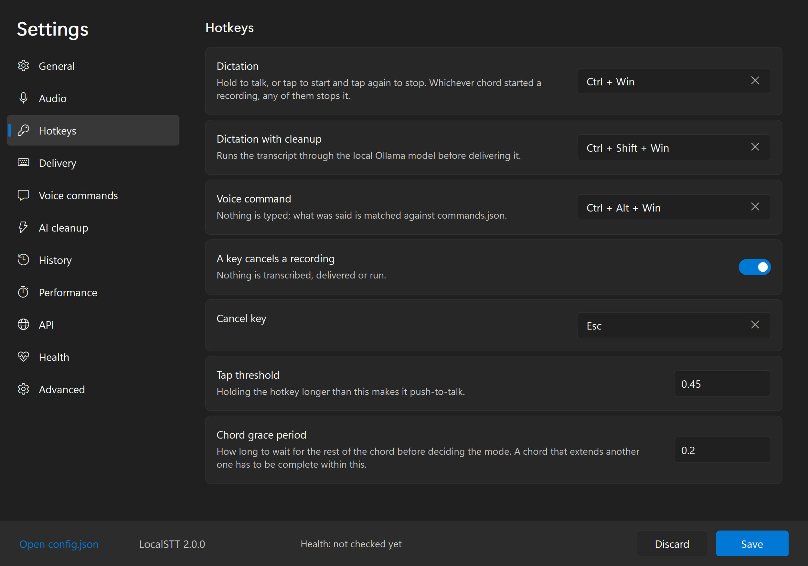
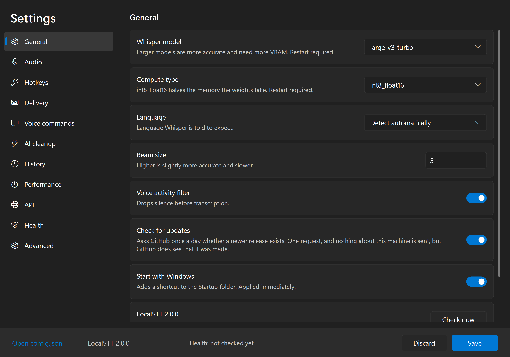
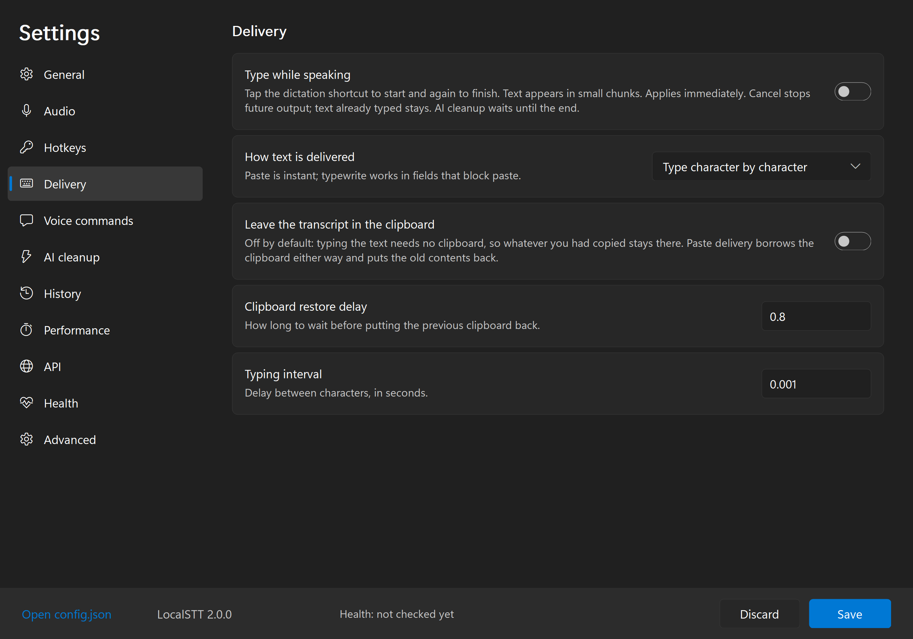

# LocalSTT

**Зажали хоткей, сказали, отпустили — текст напечатан там, где стоит курсор.**
Распознавание речи целиком на своей видеокарте: приложение в трее для Windows 11,
опциональная чистка текста локальной языковой моделью и HTTP-эндпоинт, совместимый
с OpenAI.

Ничего не выгружается наружу. Ни аккаунта, ни API-ключа, ни сетевых запросов, кроме
тех, что вы попросите сами: модель скачивается один раз, дальше всё локально.
Приложение нативное, на C++: ни Python, ни виртуального окружения, ни CUDA Toolkit для
работы не нужно.

[English version](README.md)



---

## Содержание

- [Что это умеет](#что-это-умеет)
- [Системные требования](#системные-требования)
- [Установка](#установка)
- [Хоткеи](#хоткеи)
- [Настройки](#настройки)
- [Доставка текста и буфер обмена](#доставка-текста-и-буфер-обмена)
- [Словарь](#словарь)
- [Чистка текста моделью](#чистка-текста-моделью)
- [Голосовые команды](#голосовые-команды)
- [HTTP API](#http-api)
- [Самопроверка](#самопроверка)
- [Обновления](#обновления)
- [Автозапуск](#автозапуск)
- [Файлы и папки](#файлы-и-папки)
- [Как устроено](#как-устроено)
- [Зависимости](#зависимости)
- [Версия на Python](#версия-на-python)
- [Заработает ли на macOS или Linux?](#заработает-ли-на-macos-или-linux)
- [Приватность](#приватность)
- [Лицензия](#лицензия)

---

## Что это умеет

| | |
| --- | --- |
| **Диктовка в любое поле** | Зажали `Ctrl+Win`, сказали, отпустили. Текст уходит туда, где был фокус: браузер, IDE, чат, терминал. Вместо удержания можно нажать один раз, чтобы начать, и ещё раз, чтобы закончить. |
| **Работает на GPU** | Whisper на [CTranslate2](https://github.com/OpenNMT/CTranslate2), вызываемом прямо из C++, по умолчанию `large-v3-turbo`. На современной карте — в несколько раз быстрее реального времени. |
| **Чистка моделью** | `Ctrl+Shift+Win` пропускает расшифровку через локальную модель [Ollama](https://ollama.com): убирает слова-паразиты и чинит пунктуацию, не меняя смысла. |
| **Голосовые команды** | `Ctrl+Alt+Win` сопоставляет сказанное с `commands.json` и выполняет. Ничего не печатается. Выполняется только то, что перечислено в файле. |
| **Печатает или вставляет** | По умолчанию печатает посимвольно — работает даже там, где вставка запрещена; можно переключить на вставку из буфера, если нужна скорость. |
| **Переназначаемые хоткеи** | Любое сочетание меняется прямо в настройках. Любая клавиша, не только модификаторы. |
| **HTTP API** | Совместимый с OpenAI эндпоинт `/v1/audio/transcriptions` на `127.0.0.1` — другие программы используют уже загруженную модель. |
| **Говорит, что не так** | Самопроверка смотрит драйвер, VRAM, библиотеки CUDA, микрофон и порт и объясняет, что делать, вместо падения позже. |

---

## Системные требования

| | Нужно | Пояснение |
| --- | --- | --- |
| **ОС** | Windows 10 версии 2004 (сборка 19041) или новее, 64-бита | Разрабатывается под Windows 11: меню в трее и окно настроек нарисованы в её стиле. |
| **Видеокарта** | NVIDIA с compute capability 7.0 и выше (RTX 20xx, GTX 16xx, Volta и новее) | **Режима на процессоре нет.** Без пригодного CUDA-устройства LocalSTT не стартует и объясняет почему. |
| **VRAM** | 4 ГБ свободных под модель по умолчанию | См. таблицу ниже. На тесной карте переключите тип вычислений на `int8_float16`. |
| **Драйвер** | NVIDIA 527.41 или новее | Этого требуют библиотеки CUDA 12 из комплекта. Ставить CUDA Toolkit не нужно — приложение везёт свои DLL. |
| **Диск** | ~4 ГБ | ~2.2 ГБ библиотек CUDA, cuDNN и CTranslate2 плюс модель (1.6 ГБ для `large-v3-turbo`). Сборка из исходников хранит ещё и скачанное: закладывайте ~10 ГБ. |
| **Инструменты сборки** | Только для сборки из исходников | Visual Studio 2022 Build Tools с *Desktop development with C++* (MSVC, Windows SDK, CMake). Архиву из релиза ничего из этого не нужно. |
| **Микрофон** | Любой, который видит Windows | Выбирается в `Settings → Audio` либо остаётся системным по умолчанию. |
| **Ollama** | Опционально | Только для хоткея чистки. Всё остальное работает без неё. |

Сколько VRAM реально нужно модели, замерено при `beam_size 5` на окне ~30 с:

| Модель | float16 | int8_float16 | int8 | Скачать |
| --- | --- | --- | --- | --- |
| `large-v3-turbo` (по умолчанию) | 2.4 ГБ | 1.5 ГБ | 1.2 ГБ | 1.6 ГБ |
| `large-v3` | 3.2 ГБ | 1.9 ГБ | 1.6 ГБ | 3.1 ГБ |
| `medium` | 1.8 ГБ | 1.1 ГБ | 0.9 ГБ | 1.5 ГБ |
| `small` | 0.9 ГБ | 0.6 ГБ | 0.5 ГБ | 0.5 ГБ |

Модель чистки живёт на той же карте, поэтому должна поместиться в остаток.
`Settings → AI cleanup` сам считает, что влезает, и предлагает скачать.

---

## Установка

Два пути: распаковать архив из релиза или собрать из клона.

### Скачать архив

В разделе Releases лежит `LocalSTT-<версия>-win64.zip`, внутри которого уже есть
приложение, его рантайм и модель `large-v3-turbo`. Распаковать куда угодно и запустить
`start-localstt.vbs`: ничего не устанавливается, ни Python, ни инструментов сборки.
Архив — если нужно просто чтобы работало.

### Собрать из исходников

```powershell
git clone https://github.com/iFrosta/localSTT.git
cd localSTT
.\install.ps1
```

Это всё. Установщик не выходит за пределы папки, из которой запущен:

1. проверяет Windows, видеокарту и инструменты сборки C++, а если их нет, говорит, как
   поставить,
2. скачивает в `native\` зафиксированные зависимости, каждую сверяя по SHA-256:
   CTranslate2, библиотеки CUDA и cuDNN, модель и модель тишины Silero. Колёса Python
   открываются только как ZIP-архивы ради DLL; сам Python не запускается,
3. собирает в `native-install\` `LocalSTT.exe` (приложение в трее) и `localstt-cli.exe`
   (та же программа для консоли), кладёт рядом рантайм и прогоняет нативные тесты,
4. запускает самопроверку.

Полезные ключи:

```powershell
.\install.ps1 -Autostart        # ещё и запускать вместе с Windows
.\install.ps1 -Model large-v3   # положить другую модель
.\install.ps1 -SkipBuild        # взять готовую сборку из native-install\
.\install.ps1 -SkipSelfTest     # без проверки в конце
```

Первый запуск скачивает несколько гигабайт; следующие берут всё, у чего совпадает хэш.
Если PowerShell отказывается запускать скрипт, разрешите на текущую сессию:

```powershell
Set-ExecutionPolicy -Scope Process -ExecutionPolicy Bypass
```

### Куда именно устанавливать

По умолчанию LocalSTT работает прямо из склонированной папки: портативно, без прав
администратора, обновляется через `git pull` и `.\install.ps1`. Чтобы поставить его
«по-настоящему», ключ `-InstallTo` копирует туда готовое приложение, без исходников и
файлов сборки:

```powershell
# Для текущего пользователя. Без администратора, и это рекомендуемый вариант.
.\install.ps1 -InstallTo "$env:LOCALAPPDATA\Programs\LocalSTT"

# Для всех пользователей. Нужен PowerShell, запущенный от администратора.
.\install.ps1 -InstallTo "$env:ProgramFiles\LocalSTT"
```

Установленная копия устроена так же, как архив из релиза: исполняемые файлы, их DLL,
`models\`, `licenses\`, редактируемые файлы и скрипты запуска.

Если всё же ставить на всех: работать будет всё. Настройки, история и логи и так лежат в
`%APPDATA%\LocalSTT`, а правка `commands.json`, `dictionary.json` или
`cleanup-prompt.txt` из окна настроек уходит в копию там же, а не падает на попытке
записать оригинал, доступный только для чтения.

В реестр пишется один ключ, в `HKCU\Software\Classes\AppUserModelId`: имя и иконка,
которые Windows ставит на уведомления LocalSTT. Деинсталлятор его удаляет. Больше
ничего в реестр не пишется. Папку потом можно переносить и переименовывать — все скрипты
находят себя сами. Откатить всё (запускать **из папки установки**):

```powershell
.\uninstall.ps1           # остановить, убрать автозапуск; в клоне предложит удалить сборку и скачанное
.\uninstall.ps1 -AppData  # ещё и удалить настройки, историю и логи
```

### Запуск

```powershell
.\start-localstt.vbs   # только трей, без консоли
.\run-native.ps1       # то же из PowerShell
.\run-dev.ps1          # localstt-cli.exe в этой консоли
```

Скрипты запуска передают `--root` со своей папкой: оттуда читаются `commands.json`,
`dictionary.json` и `cleanup-prompt.txt`. Одновременно работает только одна копия;
остановить её можно через `.\stop-localstt.ps1` или `Exit` в меню трея.

Цвет иконки в трее показывает состояние: зелёный — готов, красный — пишет или слушает
команду, янтарный — распознаёт или чистит. Левый клик открывает настройки, правый — меню.

---

## Хоткеи

| Сочетание | Что делает |
| --- | --- |
| `Ctrl+Win` | Диктовка. Зажать и отпустить либо нажать один раз, чтобы начать, и ещё раз, чтобы закончить. |
| `Ctrl+Shift+Win` | Диктовка с чисткой моделью перед вставкой. |
| `Ctrl+Alt+Win` | Голосовая команда. Ничего не печатается. |
| любое из трёх | Останавливает текущую запись, каким бы режимом она ни началась. |
| `Esc` | Отмена: ничего не распознаётся, не вставляется и не выполняется. |

Удержание дольше `hotkey_tap_seconds` (0.45 с) работает как push-to-talk, короткое
нажатие — как переключатель.

### Как переназначить

`Settings → Hotkeys`. Кликнули по полю, нажали сочетание, отпустили — сочетание
записывается ровно тем кодом, который потом будет его узнавать.

- Участвовать может любая клавиша, не только модификаторы: `F9` и `Ctrl+Alt+D`
  работают так же, как `Ctrl+Win`.
- Крестик справа очищает привязку — режим остаётся вообще без хоткея.
- Два режима не могут занять одно сочетание: при сохранении скажет, какие именно
  конфликтуют.
- Новое сочетание применяется при сохранении, без перезапуска.

В `config.json` они лежат как `hotkey_dictation`, `hotkey_cleanup`, `hotkey_command`
и `hotkey_cancel` в виде `"ctrl+shift+win"`.

Тонкость: чистка — это диктовка *плюс* `Shift`, то есть оба сочетания подходят под одни
и те же клавиши. Запись стартует по первому сочетанию, а режим окончательно решается
через `hotkey_mode_grace_seconds` (0.2 с) — этого хватает, чтобы досчитать аккорд,
нажатый одним движением. Непересекающихся привязок это не касается.

---

## Настройки

Клик по иконке в трее или правый клик → `Settings`. Здесь все поля `config.json`,
разложенные по разделам, а внизу — `Open config.json` для тех, которые интерфейсу лучше
не трогать. Смена модели, типа вычислений, бэкенда распознавания и порта API требует
перезапуска, остальное применяется сразу при сохранении.



| Раздел | Что внутри |
| --- | --- |
| **General** | Модель, тип вычислений, язык, beam size, фильтр тишины, проверка обновлений, автозапуск, версия |
| **Audio** | Микрофон, частота дискретизации, нормализация входа |
| **Hotkeys** | Четыре привязки, порог удержания и окно досчёта аккорда |
| **Delivery** | Печать или вставка, настройка буфера обмена, скорость печати |
| **Voice commands** | Все команды с отметкой, работают ли они на этой машине, и тайминги |
| **AI cleanup** | Какая модель Ollama, влезает ли она в остаток VRAM, кнопка скачивания |
| **History** | По умолчанию выключено. Включив, храните каждую расшифровку со временем |
| **Performance** | Сколько заняли последняя диктовка и чистка |
| **API** | Хост и порт |
| **Health** | Полная самопроверка, запускается повторно |
| **Advanced** | Бэкенд распознавания, пути к модели и к модели тишины, списки вариантов для выпадающих меню |

Микрофон — это устройство Windows `waveIn`, сохраняется как `native_microphone`. Номер
`microphone`, который сохраняет версия на Python, остаётся в файле, но нативным
приложением не используется: выберите устройство заново или оставьте системное по
умолчанию.

---

## Доставка текста и буфер обмена



Два способа положить текст в поле с фокусом:

- **Typewrite** (по умолчанию) — шлёт символы по одному через `SendInput`. Работает
  там, где вставка запрещена, и буфер обмена вообще не нужен.
- **Paste** — кладёт текст в буфер и шлёт `Ctrl+V`. Мгновенно для длинного текста.

**Буфер обмена по умолчанию не трогается.** Печать обходится без него, поэтому то, что
вы копировали до диктовки, остаётся на месте. Включите `Leave the transcript in the
clipboard` (то же самое есть в трее, в подменю `Delivery`), если хотите, чтобы каждая
расшифровка попадала ещё и туда. Вставка вынуждена занять буфер в любом случае — при
выключенной настройке она возвращает прежнее содержимое обратно.

Последняя расшифровка в любом случае пишется в
`%APPDATA%\LocalSTT\last-transcript.txt`.

---

### Текст во время речи

Включите **Settings → Delivery → Type while speaking**. Переключатель сохраняется
сразу и действует со следующей записи. Коротко нажмите сочетание диктовки (по
умолчанию Ctrl+Win), чтобы начать, затем ещё раз, чтобы закончить. При удержании
сочетания вывод ждёт отпускания клавиш-модификаторов.

Подтверждённые слова печатаются небольшими фрагментами во время записи. Короткий
контекст и быстрое декодирование могут снижать точность и менять пунктуацию по
сравнению с обработкой всей записи после остановки. Напечатанный текст не
переписывается. Отмена прекращает дальнейший вывод, уже введённый текст остаётся.
Диктовка с чисткой текста по-прежнему обрабатывает запись целиком.

Оставляйте курсор в том же поле. При переходе в другое окно ввод прекращается,
а полный текст в конце попадает в буфер обмена. При успешном вводе действует
настройка **Leave the transcript in the clipboard**.

При переключении разделов настроек прокрутка сбрасывается, кнопки Save/Discard
остаются видимыми. Фоновые проверки GPU, перезапуск и служебные скрипты не
открывают консоль; для скрипта её можно включить через `"show_console": true`.

## Словарь

Whisper коверкает техническую лексику и пишет русскую речь кириллицей даже там, где это
латинское название. `dictionary.json` решает обе задачи:

```json
{
  "terms": ["CUDA", "cuDNN", "PostgreSQL"],
  "replacements": { "ку да": "CUDA", "постгрес": "PostgreSQL" }
}
```

- `terms` уходят в модель как контекст, чтобы она вернее их писала. Это подсказка, а не
  обучение: веса Whisper не меняются, и между диктовками он ничего не помнит. Читает он
  около 220 токенов подсказки, остальное молча отбрасывает, — поэтому список терминов,
  который всё растёт, однажды тихо перестаёт работать. Когда порог перейдён, об этом
  пишется в лог.
- `replacements` применяются к расшифровке после, начиная с самых длинных фраз. Это
  надёжная половина. Если слово стабильно выходит неверно, чините здесь, а не надеждой
  на длинный список терминов.

Файл перечитывается при изменении, поэтому новое слово действует со **следующей
диктовки**, без перезапуска. Файл в комплекте — заготовка, замените своей лексикой.
Правленая копия в `%APPDATA%\LocalSTT\dictionary.json` имеет приоритет над той, что
лежит в папке, — так `git pull` её не затрёт.

---

## Чистка текста моделью

`Ctrl+Shift+Win` распознаёт и затем переписывает результат локальной моделью Ollama:
слова-паразиты вон, пунктуация на место, смысл и язык не трогаются. Технические
термины, пути, команды и код остаются как есть.

Модель делит видеокарту с Whisper, поэтому подходит та, что влезает в остаток VRAM.
Пусть LocalSTT выберет и скачает сам:

```powershell
.\install-qwen-cleanup-model.ps1
```

Посмотреть рекомендацию, ничего не меняя:

```powershell
.\native-install\localstt-cli.exe --cleanup-model
```

Указать свою, добавив `-Pull`, если её ещё нужно скачать:

```powershell
.\set-ollama-cleanup-model.ps1 -Model qwen3:4b-instruct -TimeoutSeconds 60
```

`Settings → AI cleanup` показывает ту же рекомендацию с кнопкой скачивания. Без
запущенной Ollama обычная диктовка не страдает — Ollama нужна только этому хоткею.

### Как поменять то, что делает чистка

Инструкции, которые получает модель, лежат в `cleanup-prompt.txt`, а
`Settings → AI cleanup → Edit prompt` его открывает. Перепишешь — следующая же диктовка
пойдёт по новой формулировке, без перезапуска. Можно просить другой тон, перевод на
другой язык, тезисы, краткую выжимку: расшифровка уходит пользовательским сообщением, а
этот файл — системным.

Каждая диктовка — один самостоятельный запрос к `/api/chat` Ollama: одно системное
сообщение с этим промптом и одно пользовательское с расшифровкой. Никакого диалога и
никакой памяти между диктовками нет, поэтому промпт — единственное, что управляет
результатом.

Правленая копия в `%APPDATA%\LocalSTT\cleanup-prompt.txt` имеет приоритет над файлом в
папке. Очисти файл — вернётся встроенный промпт.

---

## Голосовые команды

`Ctrl+Alt+Win` записывает, распознаёт и сверяет с `commands.json`. Режим команд слушает
непрерывно и останавливается сам, как только что-то совпало, — второй раз жать хоткей
не нужно:

- текущая запись распознаётся каждые `command_poll_seconds` (0.9 с),
- точное совпадение выполняется сразу и завершает сессию,
- совпадение с `*` ждёт `command_capture_silence_seconds` тишины, чтобы захватить фразу
  целиком, а не половину,
- если ничего не совпало, сессия кончается после `command_silence_timeout_seconds`
  тишины либо через `command_listen_timeout_seconds` в сумме.

`command_auto_stop` в `false` (в трее — `Command auto-stop`) возвращает обычный
старт/стоп.

### Шаблоны

Команда должна *открывать* фразу, поэтому болтовня её не запустит. `выключи подсветку`
совпадёт с «Выключи подсветку.» и «выключи подсветку пожалуйста», но не с «ну и потом
выключи подсветку сказал он».

| Шаблон | Совпадает с |
| --- | --- |
| `выключи подсветку` | фразой в начале сказанного |
| `создай задачу *` | фразой в начале; остаток становится захватом |
| `поставь таймер на * минут` | фразой вокруг захвата |
| `*blackout` | где угодно в предложении — включается явно, срабатывает случайно чаще |

Порядок важен: выполняется первая команда, чья фраза открывает предложение, а «открой
терминал» открывает и «открой терминал ubuntu», поэтому частные варианты идут выше
общего.

### Типы команд

Выполняется только то, что перечислено в `commands.json`. Речь никогда не запускает
произвольную команду оболочки.

- **`process`** — абсолютный существующий путь к `.exe`, `.cmd`, `.bat`, `.ps1` или
  `.vbs` с фиксированным списком аргументов. `.ps1` идёт через `pwsh.exe`, `.vbs` —
  через `wscript.exe`.
- **`localstt`** — действует на само приложение: `language`, `delivery`
  (`paste`/`typewrite`) или `repeat`, который вставляет последний текст ещё раз.
- **`microsoft_todo`** — кладётся в `%APPDATA%\LocalSTT\todo-queue.jsonl` до тех пор,
  пока не подключён Microsoft Graph.
- **`app_launch`** — открывает приложение, названное в захвате, без отдельной записи.

В путях допустимы переменные вида `%LOCALAPPDATA%` и просто имя исполняемого файла,
которое ищется в `PATH`. Команда может объявить, что ей нужно:

| Запись в `requires` | Выполнено, когда |
| --- | --- |
| `path:C:\tools\Thing.exe` | такой файл существует |
| `exe:wsl.exe` | имя находится через `PATH` |
| `appx:Microsoft.WindowsCalculator_8wekyb3d8bbwe` | этот пакет из Store установлен |
| `wsl:Ubuntu:htop` | `htop` есть в `PATH` внутри дистрибутива Ubuntu |

Команды, чья цель не установлена, выключаются сами, а не падают при произнесении.
`Settings → Voice commands` перечисляет все команды с причиной отключения, а
переключатель пишет `"enabled": false` обратно в файл.

Набор в комплекте намеренно скромный: блокировка, сон, терминалы, «Блокнот»,
«Проводник», VS Code, действия `localstt`, захват задачи в To Do и общий запуск
приложений. Добавляйте свои или положите правленую копию в
`%APPDATA%\LocalSTT\commands.json`, чтобы git её не трогал.

### Запуск приложений

`app_launch` ищет среди всего, что умеет открывать меню «Пуск», — ярлыки, пакеты из
Store и зарегистрированные app id, из папки приложений оболочки Windows. Индекс кэшируется в
`%APPDATA%\LocalSTT\app-index.json` и пересобирается раз в сутки либо по кнопке
`Settings → Voice commands → Rebuild app index`.

Произнесённые названия редко совпадают с зарегистрированными, поэтому они разбираются
нечётким сопоставлением, транслитерацией (для языков диктовки не на латинице: Whisper
пишет русскую речь кириллицей) и файлом синонимов
`%APPDATA%\LocalSTT\app-aliases.json` (`Settings → Voice commands → Edit app names`):

```json
{ "chrome": "Google Chrome", "калькулятор": "Calculator" }
```

Результаты пишутся в `%APPDATA%\LocalSTT\command-history.jsonl` (в трее —
`Command history`).

---

## HTTP API

Запущенное приложение отдаёт совместимый с OpenAI эндпоинт на `127.0.0.1:7777`, чтобы
другие программы работали с уже загруженной моделью.

```powershell
curl.exe -X POST http://127.0.0.1:7777/v1/audio/transcriptions `
  -F "file=@C:\path\sample.wav" `
  -F "model=large-v3-turbo" `
  -F "language=ru" `
  -F "response_format=json"
```

`language=auto` определяет язык сам, `language=en` заставляет распознавать английский.
Либо через обёртку:

```powershell
.\transcribe-file.ps1 C:\path\sample.wav
```

`/health` и `/metrics` показывают загруженную модель, устройство, версию и тайминги.
Поле `model` в запросе не подменяет загруженную модель. Загрузка ограничена 128 МиБ, а
аутентификации нет: оставляйте `api_host` на `127.0.0.1`.

---

## Самопроверка

LocalSTT проверяет себя при каждом запуске. Смотрит, что модель загрузилась на
устройство CUDA (и не даёт тихо откатиться на процессор), видеокарту и её VRAM,
микрофоны, отвечает ли Ollama и какая модель чистки помещается в остаток. Самопроверка
из консоли ещё и перечисляет, какие голосовые команды на этой машине выполнимы.

Останавливают запуск только те сбои, при которых распознавание невозможно: отсутствие
микрофона или занятый порт будут показаны, но приложение всё равно запустится.
Запустить проверку вручную можно из `Settings → Health` либо так:

```powershell
.\run-diagnostics.ps1   # самопроверка без приложения в трее
.\health.ps1            # спросить у запущенного приложения
```

Последний результат лежит в `%APPDATA%\LocalSTT\preflight.json`.

---

## Обновления

Раз в сутки LocalSTT спрашивает у GitHub, не вышла ли версия новее, и говорит об этом в
трее, если вышла. Это один `GET`, никаких данных о машине с ним не уходит. Выключатель и
кнопка **Check now** — в `Settings → General`, а в подвале окна настроек всегда видна
установленная версия; когда вышла новая, там появляется ссылка на неё.

Обновление ручное и зависит от способа установки: `git pull` и `.\install.ps1` в клоне
либо скачать новый архив из [Releases](https://github.com/iFrosta/localSTT/releases) и
распаковать поверх папки. Настройки и история лежат вне папки, так что ни один из
способов их не теряет. Номер версии берётся из одного места, `localstt\__init__.py`,
его читает сборка.

---

## Автозапуск

`Settings → General → Start with Windows` добавляет или убирает ярлык на `LocalSTT.exe`
в папке «Автозагрузка» и срабатывает сразу. То же самое из консоли:

```powershell
.\install-autostart.ps1
.\uninstall-autostart.ps1
```

---

## Файлы и папки

Всё, что приложение пишет, лежит в `%APPDATA%\LocalSTT`, а не в папке установки:

| Путь | Что это |
| --- | --- |
| `config.json` | Все настройки |
| `logs\localstt-native.log` | Лог приложения |
| `last-transcript.txt` | Последняя расшифровка |
| `history.jsonl` | История диктовок, если включена |
| `command-history.jsonl` | Что сделали голосовые команды |
| `performance.json` | Тайминги последней диктовки |
| `preflight.json` | Результат последней самопроверки |
| `update-check.json` | Когда последний раз проверялись обновления и что ответил GitHub |
| `app-index.json`, `app-aliases.json` | Индекс приложений и ваши синонимы названий |
| `commands.json`, `dictionary.json`, `cleanup-prompt.txt` | Необязательные. Перекрывают копии из папки установки |

Модель лежит вместе с приложением, в `models\` рядом с исполняемыми файлами
(`native-install\models\` в клоне), так что удаление папки удаляет и её. Если в кэше
Hugging Face уже есть подходящая модель, установка берёт её оттуда, а не скачивает
заново.

---

## Как устроено

Одна программа на C++20, собранная дважды: `LocalSTT.exe` без консоли для трея и
`localstt-cli.exe` с консолью для скриптов (`--transcribe`, `--serve`, `--self-test`,
`--devices`, `--cleanup-model`; полный список даёт `--help`). Исходники в `native\`:

| Файл | Что внутри |
| --- | --- |
| `main.cpp` | Запуск, перехват клавиатуры, сессии записи, доставка текста, HTTP API |
| `ui.cpp` | Иконка и меню в трее, уведомления, окно настроек в стиле Windows 11 |
| `engine.cpp`, `ct2.cpp` | Распознавание: CTranslate2 (по умолчанию) или опциональный whisper.cpp; чистка через Ollama |
| `features.cpp`, `tokenizer.cpp` | Log-mel признаки и токенизатор Whisper, сверенные с оригинальной реализацией |
| `live_dictation.cpp` | Текст во время речи: какие слова уже достаточно устойчивы, чтобы их печатать |
| `platform.cpp` | Запись с микрофона, `SendInput`, буфер обмена, декодирование аудиофайлов |
| `hotkeys.cpp` | Имена клавиш, разбор и сопоставление аккордов, проверка конфликтов хоткеев |
| `dictionary.cpp` | `dictionary.json` и `cleanup-prompt.txt`, перечитываются при изменении |
| `commands.cpp` | Сопоставление голосовых команд, белый список и индекс приложений |
| `updates.cpp` | Проверка релизов на GitHub |
| `common.cpp` | `config.json`, лог, откуда читаются редактируемые файлы |

`native\setup.ps1` скачивает зафиксированные зависимости из `native\dependencies.json`;
`native\build.ps1` конфигурирует CMake в `build-native\`, собирает, копирует рантайм в
`native-install\` и прогоняет тесты. Подробности, включая ручную сборку и тесты на
видеокарте, в `native\README.md`.

`config.json` общий с версией на Python, имена настроек те же. Нативное приложение
сохраняет все настройки, которых не знает; версия на Python при сохранении выбрасывает
чисто нативные (`native_microphone`, `native_backend` и переопределения путей к моделям),
и они возвращаются к значениям по умолчанию.

---

## Зависимости

Скачивает `native\setup.ps1`, версии и SHA-256 зафиксированы в
`native\dependencies.json`; лицензии лежат в `licenses\`.

| Компонент | Зачем |
| --- | --- |
| CTranslate2 4.8.2 | Распознавание речи, вызывается из C++ |
| cuBLAS, cuDNN, NVRTC (CUDA 12) | Рантайм видеокарты, нужный CTranslate2 |
| Whisper `large-v3-turbo` (формат CTranslate2) | Модель |
| Silero VAD | Фильтр тишины |
| whisper.cpp | Опциональный второй бэкенд (`Settings → Advanced`) |
| nlohmann/json, cpp-httplib | `config.json` и прочие файлы; HTTP API и Ollama |
| Рантайм MSVC | Лежит рядом с исполняемыми файлами, ставить redistributable не нужно |

Остальное — сама Windows: Media Foundation декодирует аудиофайлы, `waveIn` пишет с
микрофона, WinHTTP спрашивает GitHub об обновлениях.

**Опциональные**

| | Что даёт | Без него |
| --- | --- | --- |
| [Ollama](https://ollama.com) и небольшая instruct-модель | Чистку по `Ctrl+Shift+Win` | Обычная диктовка не страдает |
| Windows Terminal (`wt.exe`) | Команды открытия терминалов из комплекта | Эти команды выключаются сами |

---

## Версия на Python

LocalSTT начинался как приложение на Python; эта версия по-прежнему лежит в
`localstt\` и поддерживается в ветке `main`. В этой ветке она запасная: остановите
нативное приложение (у обоих одни хоткеи и порт) и запустите

```powershell
.\run-python-legacy.ps1
```

Ей нужно виртуальное окружение, которое создаёт `install.ps1` из `main`. Ни одна версия
не удаляет файлы другой, а номер версии в `localstt\__init__.py` у них общий.

---

## Заработает ли на macOS или Linux?

**Нет — сегодня это только Windows, и не случайно.** Переписывать пришлось бы ровно то,
что делает проект собой:

| Что | Почему только Windows | Что нужно для порта |
| --- | --- | --- |
| Печать текста | `SendInput` через `user32.dll` (`platform.cpp`) | macOS: `CGEventCreateKeyboardEvent` и разрешение Accessibility. Linux: `XTEST` либо `uinput` под Wayland |
| Работа с фокусом | `GetForegroundWindow` / `SetForegroundWindow`, чтобы вернуть текст туда, откуда пришли | macOS: `NSWorkspace` и Accessibility API. Wayland: аналога нет by design |
| Глобальные хоткеи | Низкоуровневый перехват клавиатуры Windows (`main.cpp`); клавиши Win на Mac тоже нет | Event tap на macOS, evdev или протокол композитора на Linux |
| Иконка, меню и настройки | Окна Win32, нарисованные в стиле Fluent через GDI+ и DWM (`ui.cpp`) | На macOS — нативный пункт в menu bar и окно; отрисовка не переносится |
| Автозапуск | `.lnk` в папке «Автозагрузка» | plist для `launchd` либо запись `.desktop` |
| Голосовые команды | Пути к `.exe` / `.ps1` / `.vbs`, пакеты Store, папка приложений оболочки | Совсем другая модель запуска |
| Микрофон и аудиофайлы | `waveIn` и Media Foundation (`platform.cpp`) | Core Audio, ALSA или PipeWire; библиотека декодирования |
| **Движок** | **Ничего** — CTranslate2 кроссплатформенный C++ | Эта часть просто заработает |

**На Apple Silicon есть и вторая проблема:** там нет CUDA. У CTranslate2 нет бэкенда на
Metal, поэтому порт под Mac работал бы на процессоре — на M-серии это терпимо, но
медленнее — либо его пришлось бы пересобрать на чём-то другом: `whisper.cpp` с Metal и
Core ML или MLX. Это уже другой бэкенд распознавания, а не порт.

Грубо: ядро распознавания (`engine.cpp`, `ct2.cpp`, `features.cpp`, `tokenizer.cpp`,
`live_dictation.cpp`), конфиг, словарь, сопоставление хоткеев, чистка и HTTP API
переезжают без изменений. Вызовы Windows сосредоточены в `platform.cpp`, `ui.cpp`,
перехвате клавиатуры в `main.cpp` и исполнении команд — их пришлось бы писать заново под
каждую платформу.

---

## Приватность

- Звук не покидает машину. Распознавание локальное, чистка ходит в Ollama на
  `127.0.0.1`.
- В сеть уходит ровно две вещи: зависимости и модель скачиваются при сборке (в архиве из
  релиза они уже есть) и раз в сутки у GitHub спрашивается, нет ли более новой версии. Проверка обновлений не
  сообщает ничего о машине, но GitHub видит сам запрос, а значит и адрес, с которого он
  пришёл. Выключается в `Settings → General → Check for updates` либо параметром
  `update_check_enabled: false`. Скачивание модели Ollama — третья, и только по вашей
  команде.
- История диктовок **выключена** по умолчанию. Включив её, вы храните каждую
  расшифровку открытым текстом в `%APPDATA%\LocalSTT\history.jsonl`.
- Буфер обмена по умолчанию не трогается.
- Голосовые команды выполняют только то, что перечислено в `commands.json`. Речь
  никогда не запускает произвольную команду оболочки.

---

## Лицензия

MIT — см. [LICENSE](LICENSE).
